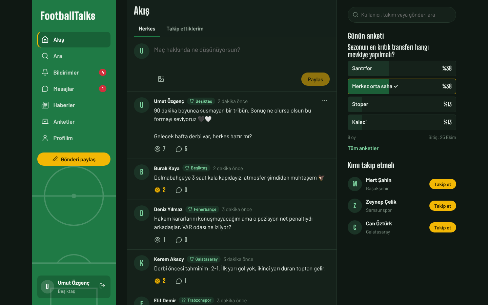
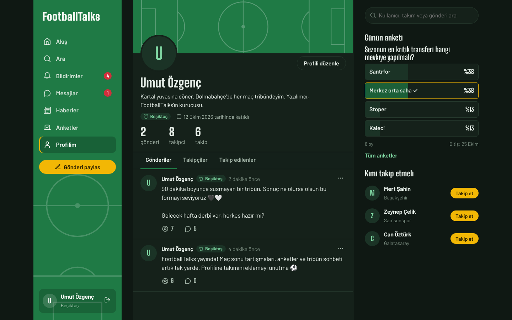
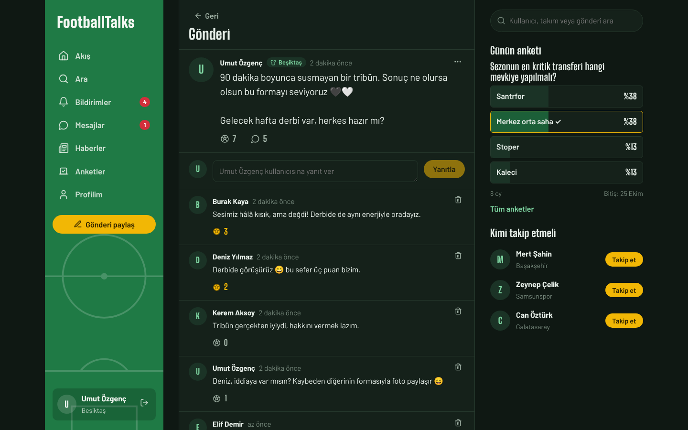
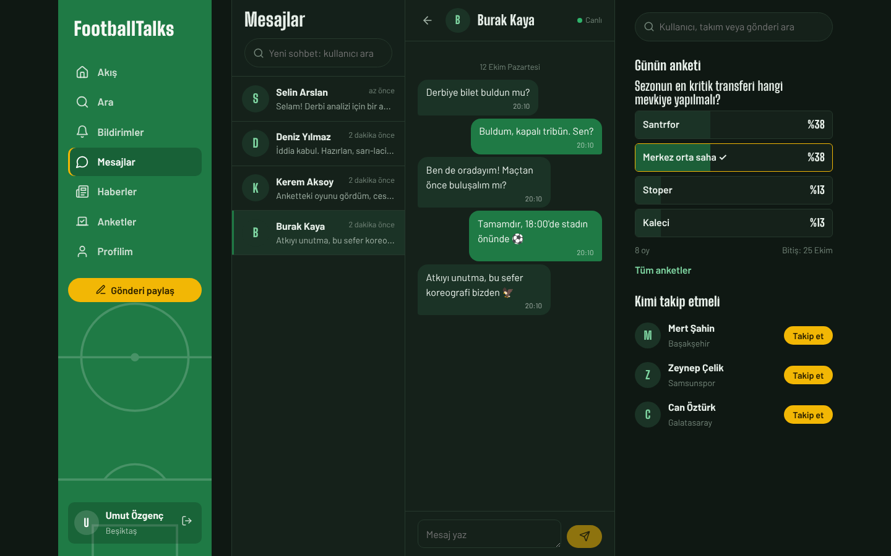
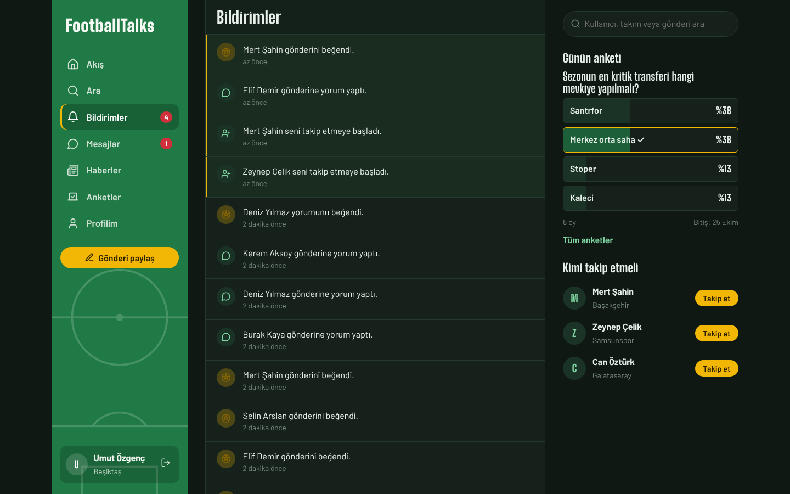
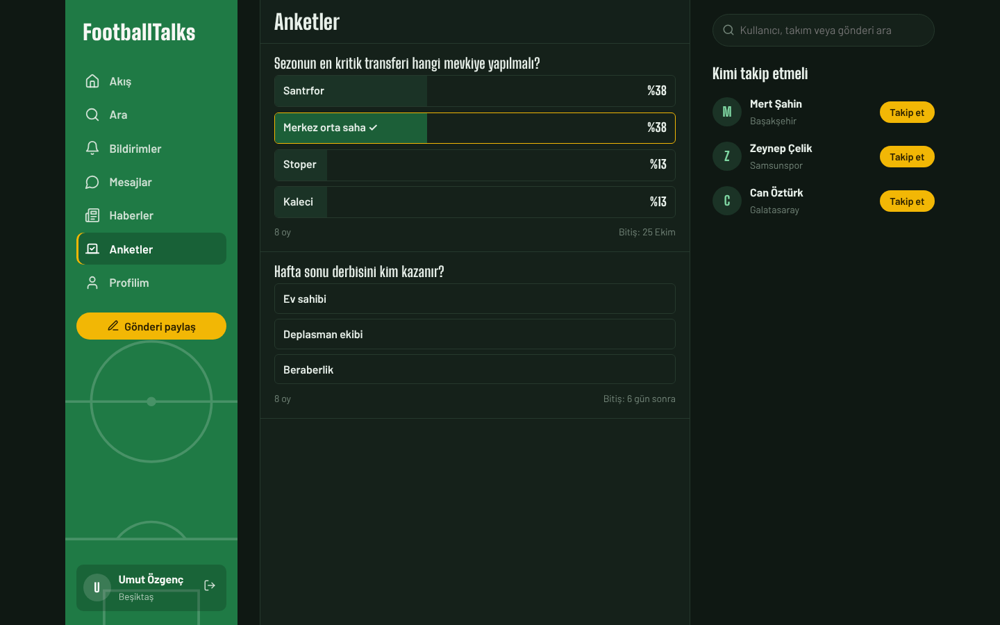
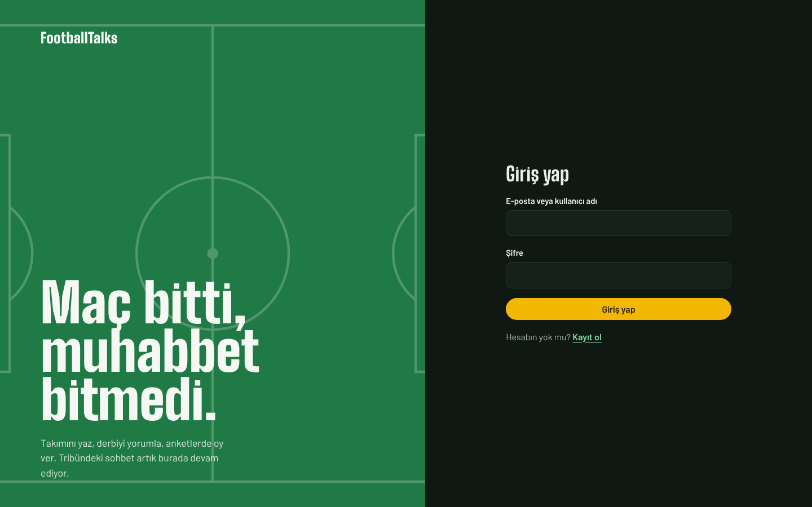
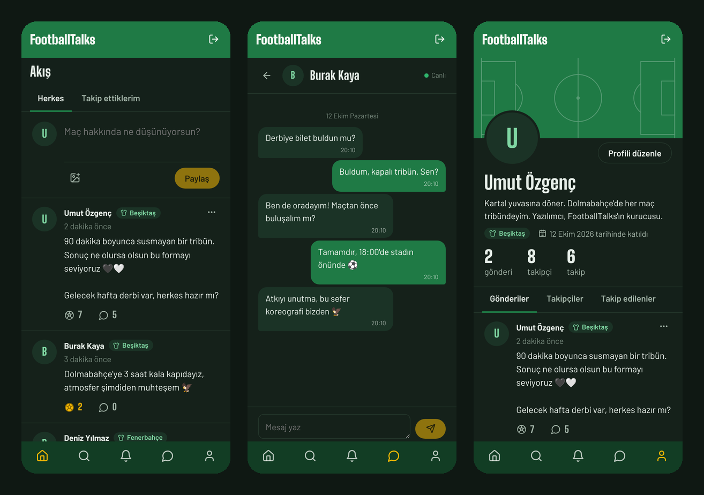
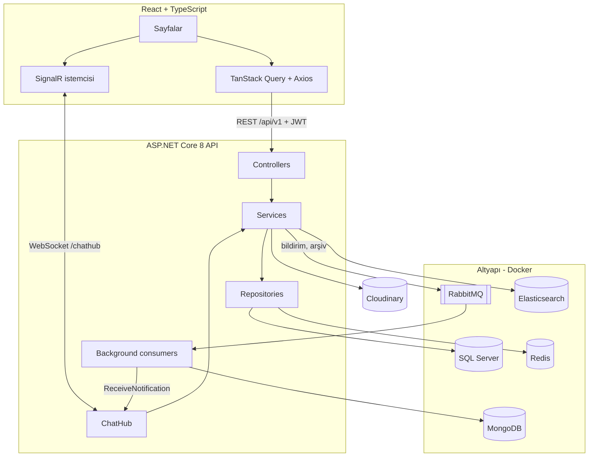

# FootballTalks

**Futbolseverler için sosyal medya.** Maç sonu yorumunu paylaş, derbiyi tartış, haftanın anketinde oy ver, tribün arkadaşınla anlık mesajlaş.

ASP.NET Core 8 ile katmanlı mimaride yazılmış bir REST API, SignalR ile gerçek zamanlı iletişim, RabbitMQ ile asenkron bildirimler, Elasticsearch ile arama ve React + TypeScript ile yazılmış bir arayüzden oluşur.



## Neler yapabilirsin?

- **Akış:** Herkesin ya da sadece takip ettiklerinin gönderileri; sonsuz kaydırma, fotoğraf ve video paylaşımı
- **Etkileşim:** Gönderi ve yorumları beğenme (⚽), yorum yapma, kendi içeriğini düzenleme ve silme
- **Profil:** Tuttuğun takım, biyografi, profil fotoğrafı, takipçi ve takip listeleri
- **Mesajlaşma:** Birebir, gerçek zamanlı sohbet; okunmamış mesaj göstergeleri
- **Bildirimler:** Beğeni, yorum, takip ve mesaj bildirimleri anında düşer
- **Anketler:** Kişi başı tek oy, süre sonu, canlı yüzde çubukları
- **Haberler:** Görselli futbol haberleri
- **Arama:** Kullanıcı, takım ve gönderi araması; yazarken otomatik tamamlama
- **Karanlık mod ve mobil uyum:** Sistem temasına göre açılır, telefonda alt menüyle çalışır

## Ekran görüntüleri

| Profil | Gönderi ve yorumlar |
| --- | --- |
|  |  |
| **Gerçek zamanlı mesajlaşma** | **Bildirimler** |
|  |  |
| **Anketler** | **Giriş** |
|  |  |

**Mobil**



## Teknolojiler ve kullanım amaçları

### Backend

| Teknoloji | Ne için kullanıldı |
| --- | --- |
| **ASP.NET Core 8 Web API** | REST API, katmanlı mimari (Core, Model, Repository, Service, Api) |
| **Entity Framework Core + SQL Server** | Kullanıcı, gönderi, yorum, beğeni, takip, anket ve mesaj verileri; migration'larla şema yönetimi |
| **ASP.NET Core Identity + JWT** | Kayıt/giriş, rol tabanlı yetkilendirme (`user`, `admin`), access + refresh token |
| **SignalR** | Gerçek zamanlı mesajlaşma ve anlık bildirim (`/chathub`) |
| **RabbitMQ** | Bildirimleri asenkron işlemek; 30 günden eski mesajları arşive taşımak |
| **MongoDB** | Bildirimler ve arşivlenmiş mesajlar (cold storage) |
| **Redis** | Gönderi listesi için dağıtık cache (decorator pattern, Scrutor) |
| **Elasticsearch + Kibana** | Gönderi ve yorumlarda bulanık (fuzzy) arama, otomatik tamamlama |
| **Cloudinary** | Gönderi görselleri/videoları, profil fotoğrafları ve haber görselleri |
| **FluentValidation** | İstek doğrulama (kayıt, gönderi, yorum, anket kuralları) |
| **AutoMapper** | Entity ↔ DTO dönüşümleri |
| **Asp.Versioning + Swagger** | `api/v1` sürümleme, JWT destekli interaktif API dokümantasyonu |
| **NewId** | Sıralı GUID üretimi (index dostu birincil anahtarlar) |
| **BackgroundService** | RabbitMQ consumer'ları ve günlük mesaj arşivleme işi |

### Frontend

| Teknoloji | Ne için kullanıldı |
| --- | --- |
| **React 18 + TypeScript** | Tip güvenli bileşen tabanlı arayüz |
| **Vite** | Hızlı geliştirme sunucusu ve build |
| **TanStack Query** | Sunucu verisi cache'i, sonsuz kaydırma, optimistic update (beğeni, takip) |
| **React Router** | Sayfa yönlendirme ve korumalı rotalar |
| **Axios** | API istemcisi; süresi dolan token'ı refresh token ile otomatik yenileme |
| **@microsoft/signalr** | Canlı mesaj ve bildirim bağlantısı, otomatik yeniden bağlanma |
| **lucide-react** | İkonlar |
| **Fontsource** | Projeye gömülü fontlar (Big Shoulders Display, Barlow) |

### Test

| Teknoloji | Ne için kullanıldı |
| --- | --- |
| **NUnit + Moq** | Servis katmanı testleri |
| **EF Core InMemory** | Testlerde gerçek repository'lerle çalışan izole veritabanı |

## Mimari



**Bir beğeni bildiriminin yolculuğu:** `POST /likes` → beğeni SQL'e yazılır → bildirim RabbitMQ kuyruğuna bırakılır → arka plan consumer'ı MongoDB'ye kaydeder → SignalR ile gönderi sahibinin ekranına anında düşer. İstek, bildirimin işlenmesini beklemez.

**Mesaj arşivi:** Günde bir çalışan bir `BackgroundService`, 30 günden eski mesajları RabbitMQ üzerinden MongoDB'ye taşır. Sohbet geçmişi iki kaynağı birleştirerek gösterilir.

**Arama:** Gönderi ve yorumlar ayrı Elasticsearch index'lerine yazılır. Arama, bulanık eşleşmeyle gönderileri bulur; sonuçlar SQL'den güncel beğeni ve yorum sayılarıyla gelir. Elasticsearch'e ulaşılamazsa arama otomatik olarak SQL'e geçer.

## Proje yapısı

```
Core.CrossCuttingConcerns      ServiceResult, ortak exception'lar
Core.Persistence               BaseEntity, generic repository, UnitOfWork
Core.Security                  Token DTO'ları, IIdentityService (token'daki kullanıcı)
Core.Infrastructure            Cloudinary, RabbitMQ, Elasticsearch istemcileri, API versioning
FootballSocialMedia.Model      Entity'ler ve DTO'lar
FootballSocialMedia.Repository DbContext, EF konfigürasyonları, migration'lar, repository'ler
FootballSocialMedia.Service    İş kuralları, validator'lar, SignalR hub, RabbitMQ consumer'ları
FootballSocialMedia.Api        Controller'lar, Program.cs, seed, .env yükleyici
FootballSocialMedia.Web        React frontend
Service.Test                   NUnit testleri
```

## Kurulum

**Gereksinimler:** .NET 8 SDK, Node.js 20+, Docker Desktop

### 1. Ortam değişkenleri

Connection string'ler, JWT anahtarı, Cloudinary anahtarları ve admin şifresi repoya girmeyen `.env` dosyasında tutulur:

```bash
cp .env.example .env     # Windows: copy .env.example .env
```

`.env` içindeki boş değerleri doldur. Bu dosyayı hem `docker compose` hem de API okur. API tarafında iç içe ayarlar `__` ile yazılır, örneğin `TokenOption__SecurityKey`.

### 2. Altyapı

```bash
docker compose up -d
```

SQL Server (1433), Redis (6377), RabbitMQ (5672, yönetim paneli 15672), MongoDB (27018), Mongo Express (8082), Elasticsearch (9200) ve Kibana (5601) ayağa kalkar.

### 3. API

```bash
cd FootballSocialMedia.Api
dotnet run --launch-profile http
```

- API http://localhost:5187, Swagger http://localhost:5187/swagger adresinde çalışır.
- Açılışta migration'lar otomatik uygulanır, roller oluşturulur. Development ortamında `admin@fsm.com` adıyla bir admin hesabı açılır; şifresi `.env` → `SeedAdmin__Password`.

### 4. Frontend

```bash
cd FootballSocialMedia.Web
npm install
npm run dev
```

http://localhost:5173 adresini aç. API adresi `FootballSocialMedia.Web/.env` dosyasındaki `VITE_API_URL` değişkeninde.

> **Docker olmadan hızlı deneme:** `appsettings.Development.json` içinde `"Database": { "UseInMemory": true }` yaparsan SQL Server gerekmez (veriler API kapanınca silinir).

## API özeti

Tüm uç noktalar `api/v1` altındadır ve `auth` dışındakiler JWT ister.

| Grup | Öne çıkan uç noktalar |
| --- | --- |
| `auth` | `login`, `register`, `create-token-by-refresh-token`, `revoke-refresh-token` |
| `posts` | `feed?mode=all\|following`, `user/{id}`, oluştur / düzenle / sil (multipart) |
| `comments` | `post/{postId}`, oluştur / düzenle / sil |
| `likes` | gönderi veya yorum beğen / geri al, sayı |
| `follows` | takip et / bırak, `followers/{id}`, `following/{id}` |
| `users` | `me`, `{id}/profile`, `search`, `suggestions`, profil güncelleme |
| `chats` | `conversations`, `history/{userId}`, `send` |
| `notifications` | liste, `unread-count`, `{id}/read`, `read-all` |
| `polls` | liste, `{pollId}/vote/{optionId}`, oluştur / sil (admin) |
| `news` | liste, oluştur / güncelle / sil (admin) |
| `search` | birleşik arama, `autocomplete` |

**SignalR:** `/chathub?access_token=<JWT>`. İstemci `SendMessage(receiverId, message)` çağırır; sunucu `ReceiveMessage` ve `ReceiveNotification` olaylarını yollar.

## Testler

```bash
dotnet test Service.Test
```

Testler gerçek repository'ler ve in-memory bir veritabanı üzerinde çalışır. Kapsadığı senaryolar: akış ve takip filtresi, beğeni/yorum sayıları, silme yetkisi, bildirimin doğru kişiye gitmesi, ankette kişi başı tek oy.

## Geliştirici

**Umut Özgenç**: [github.com/umutozgenc34](https://github.com/umutozgenc34)
